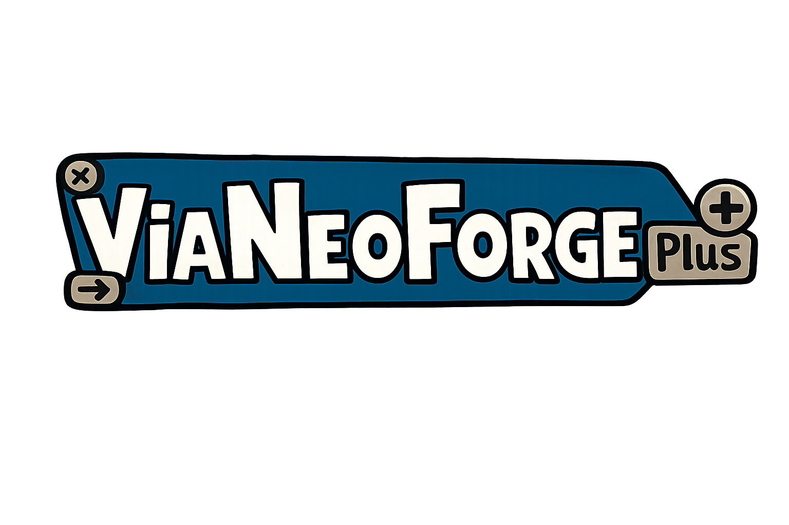

<!--suppress HtmlDeprecatedAttribute -->

  
  <h1>ViaNeoForgePlus</h1>
  
  
   
  

  
<strong>Minecraft NeoForge mod that allows you to join <em>every</em> Minecraft server version (Classic, Alpha, Beta, Release, April Fools)</strong>

**ViaNeoForgePlus** is a [NeoForge](https://neoforged.net/) port of
[ViaFabricPlus](https://github.com/ViaVersion/ViaFabricPlus) that builds on
the [ViaVersion plugin](https://github.com/ViaVersion/ViaVersion).
It lets you connect to servers from almost every Minecraft version while fixing issues that the original project
couldn't.

These fixes make older servers feel much closer to how they originally played, with improvements to movement, block and
entity interactions, graphics, and more. In short, it recreates the classic Minecraft experience on today's client.

## Important to know

- Works **only with the newest Minecraft client version**
- Runs **only on [NeoForge](https://neoforged.net/)**
- **Multiplayer only** – it does not affect singleplayer worlds
- **Clientside only** – it does not run on Multiplayer servers
- **No cross-version resource packs** — resource packs from older versions are not supported

## How to use

- [Step-by-step installation and usage guide](docs/USAGE.md)
- Found a bug? Please report it on the [issue tracker](https://github.com/fadeway37/ViaNeoForgePlus/issues)

### Supported Client versions

| **Version**                     | **Feature Updates** | **Bug Fixes** |
| ------------------------------- | ------------------- | ------------- |
| Minecraft 26.3                  | Yes                 | Yes           |
| Minecraft 26.2                  | No                  | Yes           |
| Minecraft 26.1.x *(and older)*   | No                  | No            |

### Supported Server versions

- Release (1.0.0–latest supported release*)
- Beta (b1.0 – b1.8.1)
- Alpha (a1.0.15 – a1.2.6)
- Classic (c0.0.15 – c0.30 including CPE)
- April Fools (3D Shareware, 20w14infinite, 25w14craftmine)
- Combat Snapshots (Combat Test 8c)

*[ViaVersion snapshot support](https://github.com/ViaVersion/ViaVersion#snapshot-support)

## Bedrock Edition

Support for Minecraft: Bedrock Edition servers and Realms is available through the separate
**[ViaNeoForgePlus Bedrock](https://github.com/fadeway37/viafabricplus-bedrock)** addon, a port of
[ViaFabricPlus Bedrock](https://github.com/florianreuth/viafabricplus-bedrock), which is based on
[ViaBedrock](https://github.com/RaphiMC/ViaBedrock).

## For Developers & Contributors

- [Contribution guide & dev setup](CONTRIBUTING.md)
- [API docs & integration examples](docs/DEVELOPER_API.md)

## Credits

Huge thanks to [ViaFabricPlus and its contributors](https://github.com/ViaVersion/ViaFabricPlus/graphs/contributors)
who made this project possible.

## Disclaimer

We cannot guarantee this mod will be allowed on every server.
Some servers may treat it as suspicious and flag it with anti-cheat plugins.
**Use responsibly and at your own risk!**
